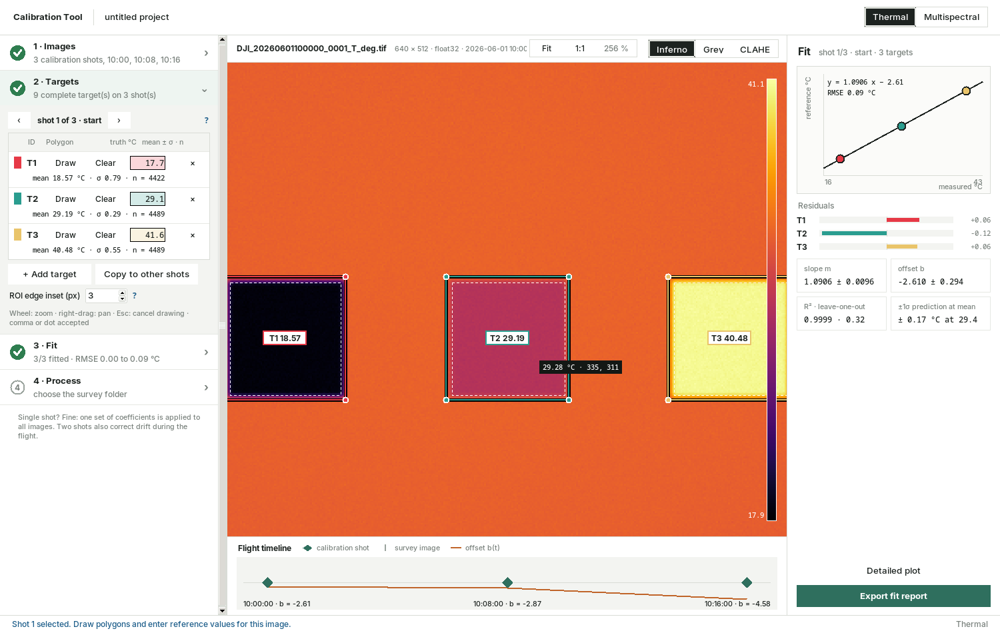
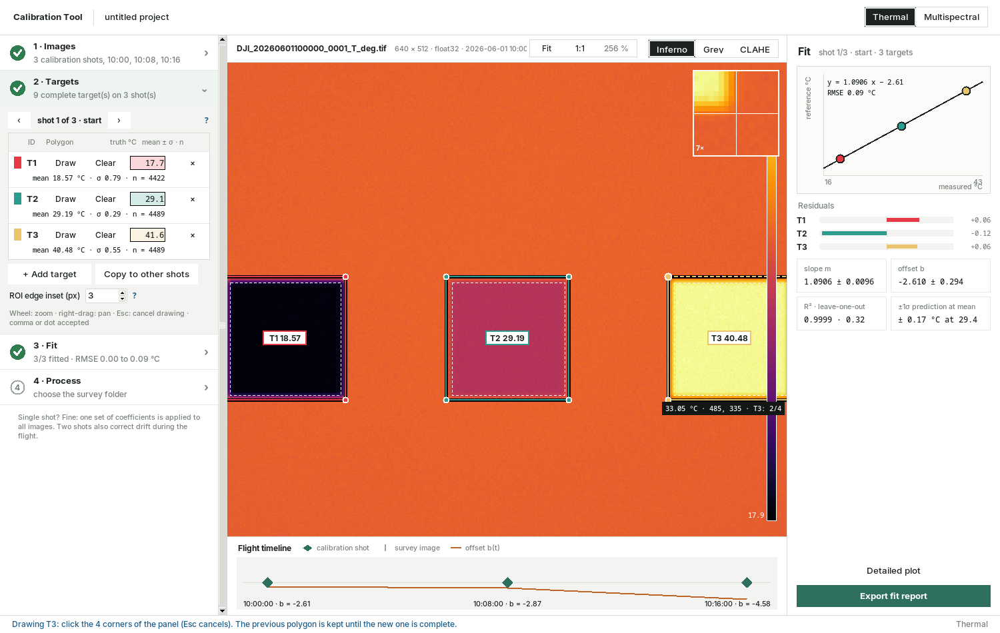
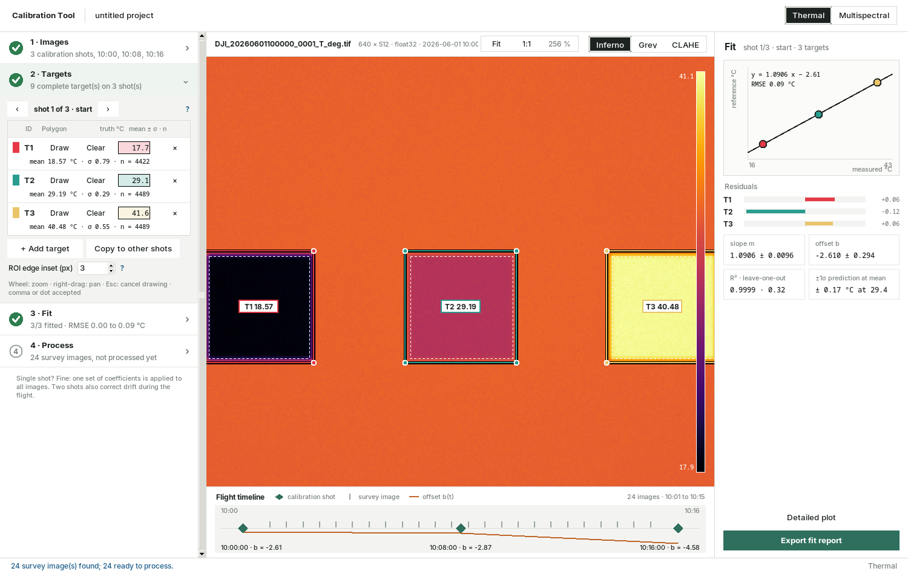
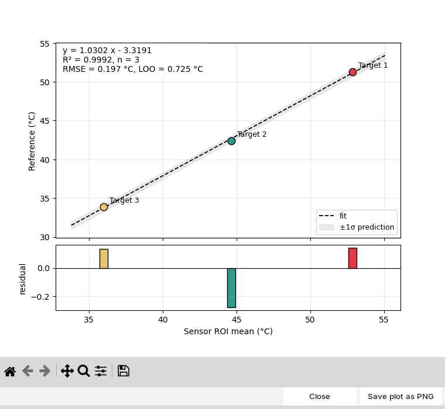
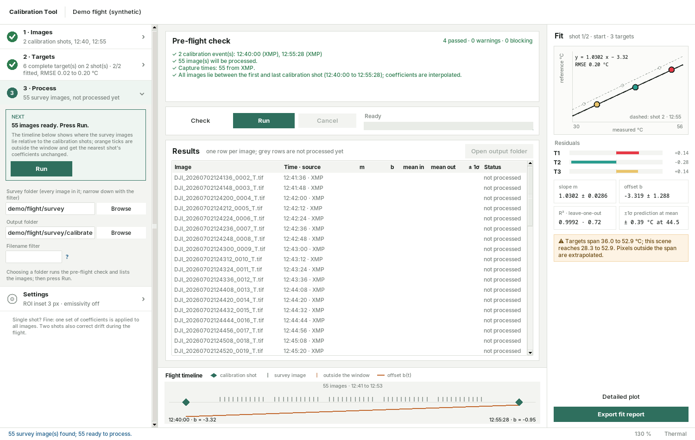
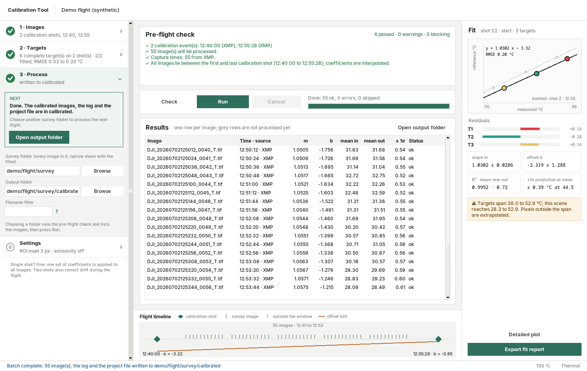

# Thermal Image Calibration Tool

[](https://github.com/MoritzNelle/GUI-Software-to-calibrate-Thermal-Images-with-Calibration-Targets/actions/workflows/tests.yml)
[](LICENSE)

A small desktop tool that corrects the drift of uncooled thermal drone cameras (built for the DJI Matrice 4T, works with any single-band temperature image) using reference targets measured in the field. It fits the Empirical Line Method, interpolates the correction over the flight, writes 32-bit float GeoTIFFs and tells you how uncertain the result is.

Version 0.2.0 (beta). Python, Tkinter, runs on Windows, macOS and Linux. The science functions are tested against closed-form references and golden data (`tests/README.md`); the GUI has been exercised on synthetic flights and real DJI M4T flights.




## Why

Uncooled microbolometer sensors drift: the same surface reads differently a few minutes later, and the absolute level is often off by several degrees. The tool corrects this with reference measurements:

1. Put 2 to 4 targets of different temperature in the scene (e.g. a wet panel, a grey panel, a black panel) and photograph them with the drone.
2. Measure each target with an IR thermometer at the same moment.
3. The tool fits `T_corrected = m × T_drone + b` from the targets.
4. Every survey image is corrected with `m` and `b`. With calibration shots at the start and the end of the flight (or more), `m` and `b` are interpolated in time, so drift during the flight is corrected too.

One calibration shot is enough; it then applies one constant correction to the whole flight. If you only take the reference shot at the end of the flight, that is fine.

## Features

- Any number of calibration images; coefficients interpolated between all of them (start, mid, end).
- Four-step layout (Images, Targets, Fit, Process) with a flight timeline and a live fit panel.
- Zoomable image (wheel), pan (right drag), loupe while placing corners, cursor readout, colour bar, Inferno / grey / CLAHE display.
- Targets are defined by 4-corner polygons; a fixed pixel inset (default 3 px) removes the blurred edge before the mean is taken, and the region actually used is drawn dashed.
- Fit diagnostics: R², RMSE, standard errors of m and b, leave-one-out error, residual bars, ±1σ prediction band, extrapolation warning; HTML fit report export.
- Per-image prediction uncertainty of the fit in the processing log, and where each image lies relative to the calibration shots.
- Pre-flight check before the batch: file types, capture-time sources, images outside the calibration window, overwrites.
- Batch runs in the background with a Cancel button; outputs keep georeferencing and (with exiftool) the full EXIF/XMP/GPS block, so Metashape, Pix4D and ODM keep camera positions and times.
- Project files (`*.calib.json`) save polygons, readings and settings; a project can be re-run headless from the command line.
- Multispectral mode: single-band DN → reflectance with one panel (K = ρ/DN) or several (empirical line).
- Comma or dot decimals, 0.0 °C is a valid reference, colour previews are refused instead of silently processed.

## Installation

Python 3.10 or newer. Tkinter ships with Python on Windows and macOS; on Linux install it with your package manager (`python3-tk` on Debian/Ubuntu, `python3-tkinter` on Fedora).

Run it from the checkout:

```bash
pip install -r requirements.txt
python thermal_calibration_tool.py
```

Or install it as a package, which adds the `thermal-calibration-tool` command (the `exif` extra reads capture times from JPEG/TIFF EXIF headers, the `test` extra pulls in pytest):

```bash
pip install ".[exif]"
thermal-calibration-tool
```

`exiftool` is optional. If it is on the PATH, EXIF/XMP/GPS metadata is copied to the outputs; without it only GDAL tags (capture time, georeferencing) survive.

## Input: temperature images, not R-JPEGs

The tool needs **single-band images whose pixel values are temperatures** (or digital numbers in multispectral mode), typically 32-bit float TIFFs. DJI cameras save radiometric JPEGs (`*_T.JPG`): a colour preview with the raw thermal data embedded. The colour preview is *not* a temperature image, and the tool refuses it. Convert R-JPEGs first with the DJI Thermal SDK, for example through the [thermal_parser](https://github.com/SanNianYiSi/thermal_parser) wrapper; `tests/convert_rjpeg.py` in this repository is a working example that also copies the EXIF/XMP block to the TIFF:

```bash
python tests/convert_rjpeg.py path/to/rjpegs path/to/tifs
```

Two things to know about that step:

- The SDK applies its own measurement parameters from the R-JPEG (emissivity 0.95, distance 5 m, humidity 50 % on the M4T). Leave the tool's emissivity correction **off** unless you converted with emissivity 1.0.
- DJI Thermal SDK 1.7 added a fifth field (`ambient_temp`) to its parameter struct. Wrappers that still declare four floats (thermal_parser at the time of writing) corrupt memory with that SDK; `tests/dji_sdk.py` has the corrected struct.

## Workflow

The window has four steps on the left (Images, Targets, Fit, Process), the image with a flight timeline in the
centre and a live fit panel on the right. Each step shows a tick once it is done. The project title in the top
bar is editable (click it); File and Help are in the menu bar (Ctrl+O opens, Ctrl+S saves).

### 1 · Images

**Add images**: the calibration shots that show the targets. They are sorted by capture time (XMP, EXIF or
TIFF tag; the source is shown). One image is fine.

### 2 · Targets

1. **Zoom in** with the mouse wheel until the targets are large; right-drag pans, Fit and 1:1 reset the view.
2. For each target press **Draw** and click its 4 corners; a loupe in the corner magnifies the pixels under
   the cursor and the readout next to it shows the value. The row shows the ROI mean, its spread and the
   number of pixels used; the dashed outline on the image is the region actually used (edge inset, default 3 px).
   **Esc** cancels a drawing; the previous polygon is kept until a new one is complete.

   

3. Type the IR thermometer reading in the **truth** field (comma or dot).
4. Switch shots with ‹ › and repeat. Targets are shared by all shots: **+ Add target** adds it to every
   shot, × removes it everywhere; only the polygons and readings are per shot. **Copy to other shots** copies
   polygons when the camera did not move.

### 3 · Fit

The panel on the right updates with every reading: a regression plot with the ±1σ prediction band,
residual bars per target, m and b with their standard errors, R², leave-one-out error and the ±1σ prediction
uncertainty at the mean target value. Warnings appear in plain words (two targets, negative slope,
extrapolation beyond the target span). **Detailed plot** opens a matplotlib window; **Export fit report**
writes a self-contained HTML report for a methods section. Step 3 in the rail holds the optional emissivity
correction.

The timeline under the image shows the calibration shots as diamonds, the survey images as ticks (orange
when outside the calibration window) and the offset b(t) that will be interpolated.





### 4 · Process

1. Choose the **survey folder** (every image in it is processed; use the filename filter, e.g. `_T_deg`, to
   narrow down) and the output folder. The capture times are read in the background, appear on the timeline,
   the pre-flight check runs by itself and every image is listed in the results table as *not processed*.
   The pre-flight list says what will happen: how many images, where their capture times come from, how many
   fall outside the calibration window, which files will be skipped or overwritten. **Check** repeats it.

   

2. Press **Run**. The window stays responsive; **Cancel** stops after the current image; the rows fill in
   one by one with the same columns as the log.



### Output files

| File | Content |
|------|---------|
| `*_calibrated.tif` | 32-bit float GeoTIFF (LZW, floating-point predictor), georeferencing and metadata copied from the source, calibration formula in the tags |
| `processing_log.csv` | One row per image: capture time and its source, position relative to the calibration shots, m, b, statistics before and after, percentage of pixels outside the target range, uncertainty terms |
| `processing_summary.txt` | Human-readable summary of events, method and settings (UTF-8) |
| `<title>.calib.json` | The project as it was run (images, polygons, readings, settings), so the run can be reopened or repeated from the command line |

Earlier outputs (`*_calibrated.tif`) in the input folder are never calibrated again.

## Uncertainty

The fit panel and the fit report give the standard regression diagnostics, all of which need at least three targets:

- RMSE `√(SSE/n)`, a descriptive number; the residual standard error `s = √(SSE/(n−2))` is the one the standard errors are built from.
- Standard errors of m and b, R², and the leave-one-out error (refit without each target, predict it).
- The ±1σ prediction uncertainty of a corrected value, `s·√(1 + 1/n + (x−x̄)²/Sxx)`. With three targets this has one degree of freedom, so a 68 % interval is about 1.8 times wider than the 1σ figure (1.3 times with four targets); read it as an order of magnitude, not a confidence interval.

Each row of `processing_log.csv` carries that prediction uncertainty evaluated at the image's mean sensor value (`u_fit_1sigma`), from the calibration shot(s) actually applied to that image: between two shots the larger of the two is reported, before the first or after the last only that shot counts. `position_vs_calibration` says whether the image lies before, between or after the shots, and `pct_pixels_outside_target_range` how much of it is extrapolated beyond the temperature span of the applied targets; the canopy is often colder than the coldest panel, so choose a cold target (a wet surface) deliberately.

This covers the regression only. Not included: the accuracy of the reference thermometer, drift between calibration shots, emissivity mismatch between targets and scene, atmospheric path, spatial non-uniformity of the sensor.

## Project files and the command line

**File → Save project** (Ctrl+S) writes a `*.calib.json` with the images, polygons, readings and settings, plus a record of the fitted coefficients and ROI statistics for the reader. Image paths are stored absolute and relative to the project file, so a flight folder that moves as a whole still opens. Re-open it later, or run it without the GUI:

```bash
python thermal_calibration_tool.py --project flight.calib.json --run
python thermal_calibration_tool.py --project flight.calib.json --run --survey /data/flight2 --output /data/flight2/calibrated
thermal-calibration-tool --version
```

The headless run performs the same pre-flight check and writes the same files. Pixels marked nodata in the input (or NaN) stay nodata in the output; the output GeoTIFF declares NaN as its nodata value, so GIS software ignores them.

## Emissivity correction (Advanced, usually off)

The empirical line already absorbs the panels' emissivity, and the DJI SDK applies an emissivity when converting R-JPEGs (0.95 on the M4T). Enable the correction only if your images are apparent temperatures (converted with ε = 1.0). Sensor drift acts on what the sensor sees, so the correction works in apparent-temperature space: the reference readings are converted to the apparent temperature of each panel (its true temperature through the panel emissivity), the fit maps raw sensor values to those, m and b are applied to the raw survey pixels, and the result is converted to surface temperature with the scene emissivity (vegetation about 0.97 to 0.99). Broadband grey-body approximation:

```
T_app⁴ = ε · T_obj⁴ + (1 − ε) · T_sky⁴
```

One thing no calibration can remove: images converted at ε 0.95 of a scene whose true emissivity is 0.98 read about 1.3 to 1.6 °C too warm under a clear sky, because panels and thermometer sit at 0.95 as well. If that matters for your question, convert with ε 1.0 and use this correction.

## Multispectral mode

Switch **Sensor** to Multispectral for single-band reflectance calibration without an irradiance sensor. Load one band at a time (use the filename filter for the batch). Single-point mode uses one panel (K = ρ/DN); multi-point mode fits ρ = m·DN + b from two or more panels of different reflectance. DN must be comparable between the calibration and survey images (same exposure/gain, or normalised beforehand).

## Field protocol (short)

- 3 targets of clearly different temperature, each at least 10 to 15 px wide in the calibration shot (fly lower for that shot, or hold the drone over the panels as in the screenshots).
- Measure every target with the IR gun within a minute of the drone shot; write the readings down with the time. Note the gun's emissivity setting.
- Repeat at the end of the flight if drift matters (long flights, changing weather). A second shot taken mid-flight still helps: images after it get its coefficients, and the pre-flight check says how many that are.
- Keep the camera's clock right; capture times drive the interpolation.

## Tests and test data

```bash
python -m pytest tests -q                       # closed-form checks, properties, golden data, I/O, GUI
python tests/make_synthetic_flight.py           # synthetic M4T-like flight with known drift
python tests/screenshot_gui.py                  # drives the real GUI and captures the screenshots
```

See `tests/README.md` for what the suite guarantees, the golden data, the synthetic flight generator, the DJI SDK conversion of real R-JPEGs and the screenshot driver. CI runs the suite on Ubuntu (with a virtual display) and Windows.

## Mathematical background

Empirical line: `T_corrected = m × T_drone + b`, with `T_drone` the mean of the inner region of each target polygon (edge inset in pixels) and `T_ref` the reference reading; m and b by ordinary least squares.

Temporal interpolation across calibration events at times t₀ < t₁ < … : `m(t)`, `b(t)` piecewise linear between consecutive events, clamped to the first/last values outside the window.

## Further reading

Background on why uncooled thermal cameras need field calibration and how the empirical line method is used for it:

- Kelly, J. et al. (2019). *Challenges and Best Practices for Deriving Temperature Data from an Uncalibrated UAV Thermal Infrared Camera.* Remote Sensing.
- Han, Y. et al. (2020). *Field-Based Calibration of Unmanned Aerial Vehicle Thermal Infrared Imagery with Temperature-Controlled References.* Sensors.

## Reporting problems and contributing

Please use the [issue tracker](https://github.com/MoritzNelle/GUI-Software-to-calibrate-Thermal-Images-with-Calibration-Targets/issues); the bug template asks for the `processing_log.csv` and, if possible, one calibration image, which is what makes a report actionable. See `CONTRIBUTING.md` for the development setup and the rules for changes to the method. Changes are listed in `CHANGELOG.md`.

## How to cite

If the tool contributes to a publication, please cite it. `CITATION.cff` holds the metadata (GitHub shows a "Cite this repository" button from it):

> Nelle, M. (2026). *Thermal Image Calibration Tool: Empirical Line calibration of drone thermal images with field targets* (version 0.2.0) [Software]. https://github.com/MoritzNelle/GUI-Software-to-calibrate-Thermal-Images-with-Calibration-Targets

A versioned DOI (Zenodo) will be added once the repository is archived there.

## Author, acknowledgements and license

Developed and maintained by [Haystack Imaging](https://haystackimaging.eu) (Moritz Nelle).


GNU General Public License, version 3 (GPL-3.0-only), see `LICENSE`. Copyright 2026 Moritz Nelle. The DJI Thermal SDK, needed to convert R-JPEGs, is DJI's and is not part of this repository.
