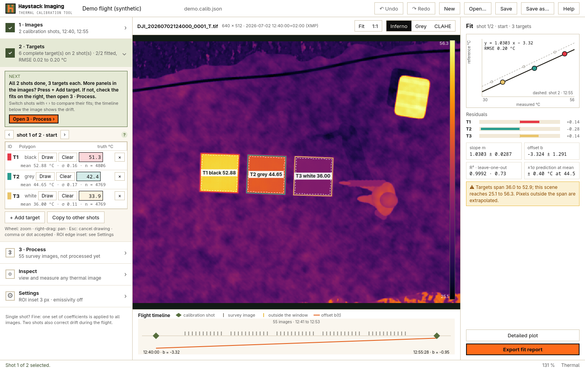

# Thermal Image Calibration Tool

[](https://github.com/haystack-imaging/thermal-calibration-tool/actions/workflows/tests.yml)
[](LICENSE)

Uncooled thermal drone cameras drift: the same surface reads differently a few minutes later, and the absolute level is often several degrees off. This tool corrects that with reference panels you measure in the field (Empirical Line Method). It is built for the DJI Matrice 4T and works with any single-band temperature image. You get a calibrated 32-bit float GeoTIFF per image and a log that says how uncertain each one is.



## Install

Download the installer for your system from the [latest release](https://github.com/haystack-imaging/thermal-calibration-tool/releases/latest):

| System | File | First start |
|--------|------|-------------|
| Windows 10 or 11 | `…_x64-setup.exe` (or the `.msi`) | Windows warns about an unknown publisher: *More info*, then *Run anyway* |
| macOS (Apple silicon and Intel) | `…_universal.dmg` | Drag the app into *Applications*. macOS blocks the first start: open *System Settings* → *Privacy & Security* and click *Open Anyway* |
| Linux | `….AppImage` (make it executable, then run it), or the `.deb` / `.rpm` package | |

The installers are not signed, which is why Windows and macOS ask once. GitHub builds them from the tagged source with the public workflow `.github/workflows/release-app.yml`, and `SHA256SUMS.txt` in the release has their checksums. If you have doubts about running an unsigned program, the source code is open and public: you can read it and build the app yourself (see [rust/README.md](rust/README.md#building)), or use the [Python version](#the-python-version).

## Try it with the demo flight

In the app, click *Open* → *Open demo flight*. The demo flight is synthetic: a wheat trial with three reference panels, flown by a simulated M4T whose readings drift by about 3 °C during the flight. The panels are drawn and the thermometer readings are typed in already. Look at the fits in step 2, then press *Run* in step 3. *Open output folder* shows the calibrated images.

The same flight is attached to every release as `demo-flight.zip`, for the Python version or to look at the files. Unpack it and open `demo.calib.json`. `ground_truth.json` in it has the camera's real gain and offset for every image, so you can check the tool's numbers against them.

## How it works

1. Lay out two to four panels of clearly different temperature, for example a wet one, a grey one and a black one, and photograph them with the drone at the start and at the end of the flight.
2. Measure each panel with an IR thermometer at the same time.
3. The tool fits `T = m × T_drone + b` for each calibration shot and interpolates m and b over the flight (in a straight line between two shots, constant before the first and after the last), so the drift during the flight is corrected too.

One calibration shot also works. It then applies one constant correction to the whole flight, and it can be taken at the end.

## Using the app

The app has three steps on the left. A NEXT card at the top of each step says what to do next.

1. Images: choose thermal or multispectral, then add the calibration shots (the images that show the panels).
2. Targets: click the corners of each panel on the image and type the thermometer reading. Do this on every shot. The fit panel on the right updates with every reading.
3. Process: choose the folder with the survey images and an output folder, read the pre-flight list and press *Run*.

The mouse wheel zooms, right-drag pans and Ctrl+Z undoes. *Settings* below the steps holds the edge inset of the panels (default 3 px), the emissivity correction and the metadata options. *Inspect* opens any image, or the results after a run, to read values and measure areas.

## Your own images

The tool needs single-band images whose pixel values are temperatures, usually 32-bit float TIFFs. DJI cameras save radiometric JPEGs (`*_T.JPG`): a colour preview with the raw data hidden inside. The preview is not a temperature image, and the tool refuses it. Convert the R-JPEGs first with the DJI Thermal SDK, for example through the [thermal_parser](https://github.com/SanNianYiSi/thermal_parser) wrapper. `tests/convert_rjpeg.py` in this repository does that and copies the EXIF/XMP block as well:

```bash
python tests/convert_rjpeg.py path/to/rjpegs path/to/tifs
```

The SDK applies its own emissivity (0.95 on the M4T), so leave the tool's emissivity correction off unless you converted with emissivity 1.0. DJI Thermal SDK 1.7 added a fifth field to its parameter struct. Wrappers that still declare four fields (thermal_parser at the time of writing) corrupt memory with it, and `tests/dji_sdk.py` has the fixed struct.

## In the field

- Use three panels of clearly different temperature, each at least 10 to 15 px wide in the calibration shot. Fly lower for that shot.
- The crop is often colder than the coldest panel. A wet panel keeps the crop inside the calibrated range.
- Measure every panel within a minute of the drone shot. Write down the time and the thermometer's emissivity setting.
- Take a second calibration shot at the end of the flight. One in the middle helps too.
- Keep the camera clock right, because the capture times drive the interpolation.

## What you get

| File | Content |
|------|---------|
| `*_calibrated.tif` | 32-bit float GeoTIFF with the georeferencing and metadata of the source (all of EXIF/XMP/GPS if [exiftool](https://exiftool.org) is installed, so Metashape, Pix4D and ODM keep the camera positions), and the formula in its tags |
| `processing_log.csv` | one row per image: capture time and its source, m and b, statistics before and after, the share of pixels outside the panels' temperature range, and `u_fit_1sigma` |
| `processing_summary.txt` | a readable summary of the shots, the method and the settings |
| `<title>.calib.json` | the project as it ran, to open it again or repeat the run |

## Uncertainty

With three or more panels the fit panel and the HTML fit report show the usual regression figures: RMSE, the standard errors of m and b, R², the leave-one-out error and the ±1σ prediction uncertainty `s·√(1 + 1/n + (x−x̄)²/Sxx)`. With three panels that last one has a single degree of freedom, so read it as an order of magnitude and not as a confidence interval. The log gives it for every image as `u_fit_1sigma`, from the calibration shot or shots applied to that image.

This covers the regression only. The thermometer's own error, drift between two shots, emissivity differences between panels and crop and the atmosphere are not in it.

## Emissivity correction (usually off)

Switch it on only for images converted at emissivity 1.0 (apparent temperatures). The tool then turns the readings into apparent panel temperatures with the panel emissivity, fits, applies m and b to the raw pixels and converts the result with the scene emissivity (crops about 0.97 to 0.99), using `T_app⁴ = ε·T_obj⁴ + (1−ε)·T_sky⁴`. Images converted at 0.95 of a crop at 0.98 read about 1.3 to 1.6 °C too warm under a clear sky. The calibration cannot remove that, because the panels and the thermometer sit at 0.95 as well.

## Multispectral mode

Choose Multispectral in step 1 to calibrate one band at a time to reflectance, without an irradiance sensor. One panel gives `ρ = K·DN`, two or more panels fit `ρ = m·DN + b`. Calibration and survey images need the same exposure and gain.

## The Python version

The tool started as a Python program (`thermal_calibration_tool.py`) with the same method and the same three steps. It stays the reference: the test data and the method tests come from it, and the app matches its results to better than 1e-5. Use it for the command line or to work on the method.

Download the code (green *Code* button → *Download ZIP*), unpack it and double-click `Launch.bat` (Windows), `Launch.command` (macOS, the first time right-click → *Open*) or `Launch.sh` (Linux). The first start installs what is missing into a private `.venv` folder, which takes a few minutes. You need Python 3.10 or newer from [python.org](https://www.python.org/downloads/). On Windows tick *Add python.exe to PATH*, and on Linux install `python3-tk` and `python3-venv` as well.

Without the launcher, and without a window:

```bash
pip install -r requirements.txt
python thermal_calibration_tool.py                                    # the window
python thermal_calibration_tool.py --project flight.calib.json --run  # a saved project, no window
python thermal_calibration_tool.py --project flight.calib.json --run --survey /data/flight2 --output /data/flight2/calibrated
```

The repository used to be at `github.com/MoritzNelle/GUI-Software-to-calibrate-Thermal-Images-with-Calibration-Targets`, and that address forwards here. Its history was rebuilt for the move, so a copy cloned before November 2026 cannot be updated with `git pull`. Clone it again.

## Tests

`python -m pytest tests -q` checks the method against closed-form results and golden data, and tests file handling and the window. `tests/README.md` says what the suite covers, and `rust/README.md` describes the app's own tests. CI runs both on Linux, Windows and macOS.

## Further reading

- Kelly, J. et al. (2019). *Challenges and Best Practices for Deriving Temperature Data from an Uncalibrated UAV Thermal Infrared Camera.* Remote Sensing.
- Han, Y. et al. (2020). *Field-Based Calibration of Unmanned Aerial Vehicle Thermal Infrared Imagery with Temperature-Controlled References.* Sensors.

## Problems, citation, license

Please report problems in the [issue tracker](https://github.com/haystack-imaging/thermal-calibration-tool/issues). The bug template asks for `processing_log.csv` and, if you can, one calibration image. `CONTRIBUTING.md` has the development setup and `CHANGELOG.md` the changes.

If the tool helps a publication, please cite it (GitHub's *Cite this repository* button uses `CITATION.cff`):

> Nelle, M. (2026). *Thermal Image Calibration Tool: Empirical Line calibration of drone thermal images with field targets* (version 0.3.1) [Software]. Haystack Imaging. https://github.com/haystack-imaging/thermal-calibration-tool

Developed and maintained by [Haystack Imaging](https://haystackimaging.eu) (Moritz Nelle), in collaboration with the [PANGEOS COST Action (CA22136)](https://pangeos.eu/). GNU General Public License, version 3 (GPL-3.0-only), see `LICENSE`. Copyright 2026 Moritz Nelle. The DJI Thermal SDK is DJI's and not part of this repository.
