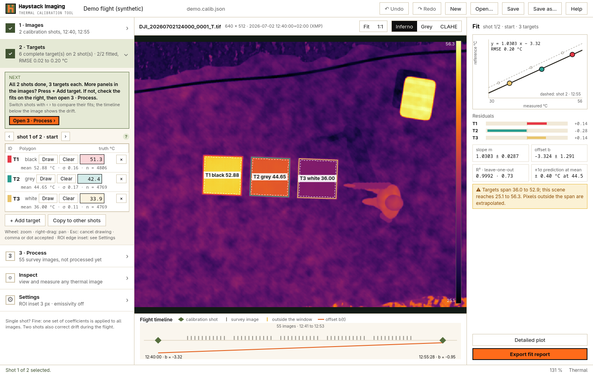

# Rust / Tauri desktop app

A port of the Thermal Calibration Tool to Rust, with a Tauri desktop shell. Installers for Windows, macOS
and Linux are on the [releases page](https://github.com/haystack-imaging/thermal-calibration-tool/releases/latest).
The Python tool in the repository root stays the reference: the golden data comes from it.



*The Targets step on the demo flight (`python demo/make_demo_flight.py`, then `--project demo/flight/demo.calib.json`).*

```
rust/
├── crates/thermal-core/   the engine: timestamps, raster I/O, ROI, fits, interpolation, batch, project files, report
├── crates/thermal-cli/    `thermal-calibration --project FILE` – headless runs, same outputs as the Python CLI
├── app/                   the desktop app: Vite + TypeScript front-end, Tauri shell in app/src-tauri
└── tools/make_golden_flight.py   builds the reference flight with the Python tool for the engine test
```

## Status

| Part | State |
|------|-------|
| Engine (`thermal-core`) | Complete port of the science core. Pure Rust: no GDAL, no OpenCV. Reads single-band TIFF (GeoTIFF, LZW/deflate), PNG, JPEG; writes float32 LZW GeoTIFFs with georeferencing, TIFF date, XMP and GDAL metadata copied; exiftool used when on the PATH, as before. HTML fit report with an SVG plot. |
| Validation | 27 engine tests, 16 front-end tests, 3 shell tests including the end-to-end flow inside the real app; the golden flight: the Python tool's `tests/golden/expected.json` reproduced to 2·10⁻⁷ (slope), 5·10⁻⁶ (intercept), 4·10⁻⁶ °C (output pixels); identical CSV columns, georeferencing and nodata. |
| CLI (`thermal-calibration`) | Done. Same arguments as `python thermal_calibration_tool.py --project … --run`. |
| Desktop app | Builds and runs on Linux, Windows and macOS (CI, end-to-end flow included). Drawing starts by itself on entering Targets and after + Add target; polygons take any number of corners (click the ringed first corner or press Enter to close, click a corner again to remove it); undo/redo with Ctrl+Z, Ctrl+Y and the top-bar buttons for polygons, readings, targets and images; help popups on the ? icons; a warning before Process when a shot still lacks targets. A typed reading (Enter or leaving the field) moves on to drawing the next target, and a click on the image starts the next polygon with that corner. During a run the results table fills in place, so it can be scrolled while images finish. A half-transparent readout next to the cursor shows the value under it on every image. The unnumbered **Inspect** section opens any single-band images or a folder (after a run it opens the calibrated outputs by itself), with the hover readout, any number of polygons per image, a table of mean, σ, min, max and pixel count, and CSV export; nothing of it is stored in the project. Three-step rail with guidance cards, canvas viewer (zoom, pan, loupe, readout, inferno / grey / CLAHE), polygon drawing, target naming, fit panel with the other shots dashed and a detailed-plot window, flight timeline, Settings, pre-flight check and a batch run with live rows, project open/save, fit report export. Two tests drive the shell's state logic through a full run on the golden flight. The app carries the Haystack Imaging identity: the website's palette as CSS tokens in `app/src/styles.css` (bone paper, ink frames, orange for the primary action, sage greens, hay for warnings) with a night-field dark theme that follows the system, the pixel wordmark in Jersey 10, the logo as window icon (`src-tauri/icons`, generated from `app/src/assets/logo.svg` with `tauri icon`), and a pixel scene on the empty canvas (`app/src/assets/scene-flight.png`, drawn with the company's pixel kit). |
| Installers | `.github/workflows/release-app.yml` builds them on every version tag (`.exe` and `.msi`, a universal `.dmg`, AppImage, `.deb`, `.rpm`), starts each built app once (`app/tests/e2e/smoke.js`) and attaches them to the release. A push that changes the workflow or `tauri.conf.json` builds them as a test. |
| Still to do | Code signing, so Windows and macOS stop asking on the first start (the macOS app is only ad-hoc signed). A real DJI flight in the app; so far it has run on the golden flight, the demo flight and the mock engine. |

## Building

The engine and the CLI need only Rust (https://rustup.rs):

```bash
cd rust
cargo build --release          # target/release/thermal-calibration
cargo test                     # unit tests; the golden test is skipped until the flight exists
python3 tools/make_golden_flight.py   # once, from the repo root's Python environment
cargo test                     # now including the comparison with the Python reference
```

The desktop app needs Node 18+ and, on Linux, the WebKitGTK development packages:

```bash
# Fedora
sudo dnf install webkit2gtk4.1-devel openssl-devel librsvg2-devel libappindicator-gtk3-devel gtk3-devel file curl wget
# Debian / Ubuntu
sudo apt install libwebkit2gtk-4.1-dev build-essential curl wget file libxdo-dev libssl-dev libayatana-appindicator3-dev librsvg2-dev
```

Then:

```bash
cd rust/app
npm install
npm run dev          # front-end alone in a browser at http://127.0.0.1:5173, with the mock engine (no Rust needed)
npm run tauri dev    # the real app against the dev server (hot reload)
npm run tauri build  # installers in app/src-tauri/target/release/bundle; --no-bundle for the binary only
```

Command-line options of the app binary: `--project FILE` opens a project at start;
`--screenshot out.png [--screenshot-delay SECONDS]` writes a snapshot of the window and exits (Linux),
which is how the screenshots are made:

```bash
app/src-tauri/target/release/thermal-calibration-app --project ../tests/data/golden_flight/flight.calib.json --screenshot shot.png
```

The shell's own tests (`cd app/src-tauri && cargo test`) also need the golden flight.

## Tests

| Layer | Command | What it covers |
|-------|---------|----------------|
| Engine | `cd rust && cargo test --workspace` | 27 unit tests (fits against closed forms, ROI fill and erosion, timestamps, raster round trip, interpolation, CSV formatting, project files, report) and the golden flight against the Python reference. |
| Front-end | `cd rust/app && npm test` | vitest with jsdom: fit panel and plot, timeline, CLAHE, payload decoding. |
| Shell | `cd rust/app/src-tauri && cargo test` | the state logic on the golden flight (open, measure, fit, pre-flight, run) and the end-to-end flow below. |
| End-to-end | part of the shell's `cargo test`; needs a display | `tests/e2e/flow.js` runs inside the real app: loads the golden shots, draws every polygon with mouse events, types the readings, checks the fits against the reference, redraw/Esc, naming, removing, the ROI inset, corner removal and five-corner polygons, the reading-to-next-target chain and click-to-start, undo/redo, the missing-targets warning, help popups, the timeline on resize, pre-flight, the batch run with its in-place rows, Inspect (opened by itself after the run, hover value, polygon statistics, CSV, per-image polygons), report export, save, new, open. The runner reuses a dev server on 127.0.0.1:5173 or starts one. `tests/e2e/dialog.js` is a manual check that the real native file dialog opens. See `app/tests/e2e/README.md`. |

`.github/workflows/rust.yml` runs all of it on Ubuntu, Windows and macOS (on Ubuntu the app runs on a
virtual display); `release-app.yml` builds the installers.

## Troubleshooting

- **The window stays empty (plain grey) and one `WebKitWebProcess` sits at 100 % CPU.** WebKitGTK's
  font enumeration was stalling on a stale user font cache. Rebuild it: `fc-cache -f` (a second or two),
  then start the app again. Found on Fedora 44 with WebKitGTK 2.54.
- **`npm run tauri dev` cannot reach the dev server.** It is pinned to `http://127.0.0.1:5173` on both
  sides (vite.config.ts and tauri.conf.json), because WebKit may try `::1` first for `localhost`.

## Design notes

- The front-end receives each calibration image once as float32 pixels and does zoom, pan, colour
  mapping, CLAHE, the loupe and the readout itself; the Rust side measures ROIs, fits and runs the batch.
- Commands and their JSON shapes are in `app/src-tauri/src/lib.rs` (Rust) and `app/src/types.ts`
  (TypeScript). `app/src/mock.ts` imitates them for browser-only development and is never loaded in
  the desktop app.
- The polygon fill includes boundary pixels, as OpenCV's `fillPoly` did in the Python tool, so the ROI
  statistics match for the usual axis-aligned targets; the inset erodes with a square element.
- Timestamps follow the Python rules exactly (camera wall time, zone recorded but not applied).
- The Tauri shell is a stand-alone cargo project (excluded from the engine workspace) because it needs
  WebKitGTK to build; the engine and the CLI do not.
